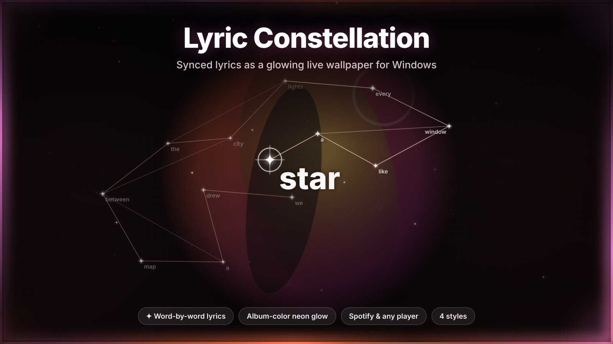

# Lyric Constellation

**Synced lyrics as a glowing live wallpaper for Windows.**

The song you're playing shows up word by word as stars that join into a constellation, and a neon glow in your album's colors runs around the edges of your screen.

## ⬇️ Download

Get **LyricConstellationSetup.exe** from the [latest release](../../releases/latest), run it and click **Install**. The setup wizard opens on first start. You get a 7-day free trial, then activate with your license key.

> Windows may say **"Windows protected your PC"** because the app is new. Click **More info → Run anyway**.

## ✦ Features

- Word-by-word synced lyrics that follow play, pause and seek
- Neon edge glow in each album's colors
- Album art softly in the background, with a big cover intro on every new song
- 4 styles: **Constellation, Minimal, Big Cover, Neon**
- Choose your own font, glow color, brightness and speed
- **Lock Mode**: a full-screen lyrics view when your PC is idle, then the normal Windows login
- Battery saver, and it almost pauses while you game or watch full-screen
- Works with Spotify, YouTube Music, Apple Music and any app in the Windows media controls
- No Spotify Premium and no login needed

## Requirements

- Windows 10 or 11
- [Lively Wallpaper](https://apps.microsoft.com/detail/9NTM2QC6QWS7), free, to show it as your desktop wallpaper. The setup wizard walks you through it.

## Updates

The app checks this page once a day and offers **Update now** when a new version is out.

## Lyrics

Lyric Constellation doesn't include or sell lyrics. You can choose to look them up on [LRCLIB](https://lrclib.net), a free community lyrics database, or use your own `.lrc` files.

## Help

Open an [issue](../../issues), or reply to your purchase email.
